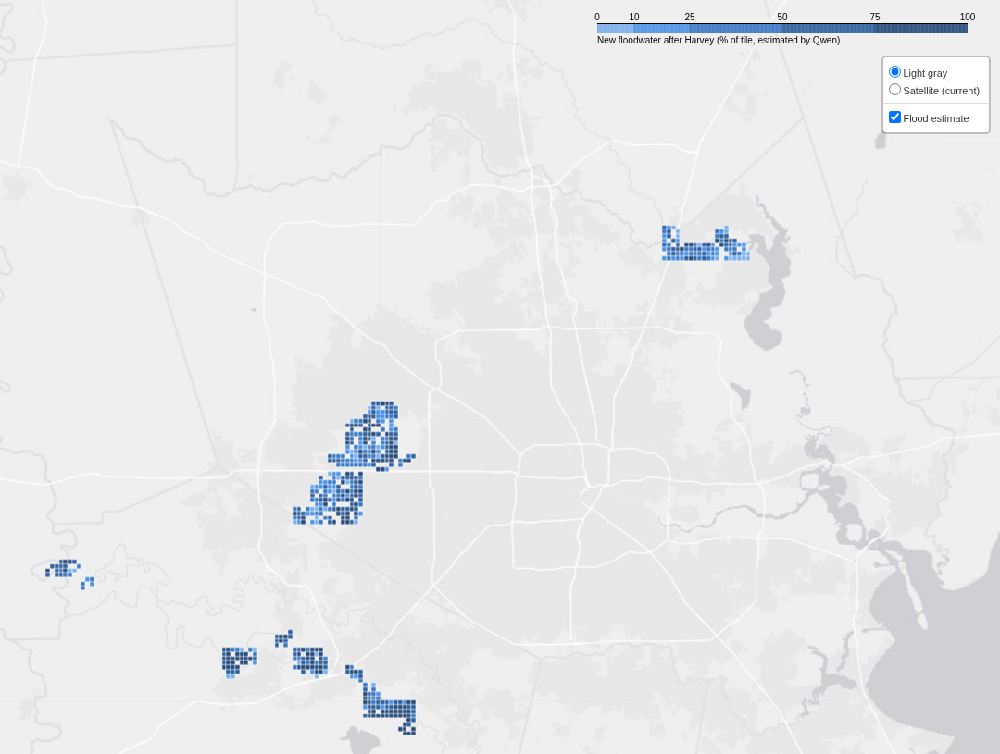

# Flood Safe Route

**Find a safe path around flooded areas, powered by a vision LLM running locally on the
Dell Pro Max GB10.**

During a flood, navigation apps still send drivers down streets that are underwater. This
project does two things: it estimates which areas flooded, from before/after aerial
photos of Hurricane Harvey (2017), and it routes around the ones it rates impassable.

The flood estimates come from a vision-language model running on a GB10, checked against
75 tiles graded by hand. Most flood deaths happen in vehicles, and nobody is driving the
streets to report which are passable — but the imagery exists for every disaster, and it
can be read locally with no network.



*Each square is one ~530 m aerial photo footprint, coloured by the share of it covered
by new floodwater. Open [`results/flood_map.html`](results/flood_map.html) in a browser
for the interactive map (hover for numbers, switch to satellite). Shown here: 550 of
575 tiles; the other 25 are near Beaumont, in the full map.*

## Try the routing demo

No install, no server, no internet, no GB10 — open the page:

```sh
xdg-open docs/route_demo.html      # macOS: open · Windows: start
```

Click **Showcase route** to watch a route bend around a flooded area, then toggle
**Recheck pass** off to see the route pass 1 alone would have sent you on — straight
through a tile the model first scored 0%.

The page opens with **sample** scores and says so in a banner. To see the real ones,
click **Load real scores** and pick [`results/flood_tiles.geojson`](results/flood_tiles.geojson),
which is committed here: 575 tiles, final scores, recheck included. The banner turns
green and the map redraws.

[`docs/DEMO_SCRIPT.md`](docs/DEMO_SCRIPT.md) is a three-minute walkthrough for presenting it.

## How it works

1. **Data.** 575 pairs of aerial photos from the
   [UTSA flood images dataset](https://huggingface.co/datasets/jennifer-fowler/UTSA-flood-images):
   a 2016 USDA photo and a NOAA photo of the same ~530 m square taken 5–9 days after
   Harvey's landfall (August 30 to September 3, 2017). The dataset links each pair through
   its `paired_image_id` column; both photos share an identical footprint.
2. **Pass 1: water percent.** Qwen3-VL-8B-Instruct, served by vLLM on the GB10, is shown
   one photo at a time and asked what percent of it is water.
3. **Subtract.** New floodwater = after-photo water − before-photo water, so rivers and
   ponds that were already there don't count.
4. **Pass 2: recheck.** Qwen sometimes reads muddy water filling the whole frame as bare
   soil. For every tile where pass 1 found no new flood (90 of 575), it is asked a yes/no
   floodwater question about the after-photo; on "yes" (39 tiles), it estimates the water
   percent again with a note that floodwater is present.
5. **Map.** Each tile is coloured by its new-floodwater percent.
6. **Check.** The team graded 75 tiles by hand, blind to the model's scores, and we
   measure how closely Qwen agrees.
7. **Route.** Each road segment takes the worst class of the tiles it touches. Above 50%
   new floodwater is impassable; 25–50%, and anything never scored, costs six times its
   length. The cheapest path wins, and a second, flood-blind search shows what was
   avoided. Thresholds, not exact percentages, because the percentages are loose (below).

## Prompts

These are the exact prompts, also in [`config.py`](config.py). Each is sent with one
1024×1024 aerial photo, at temperature 0.

**Pass 1, for every before and after photo:**

```text
This is an overhead aerial photo of a ~530 m square area in the Houston, Texas region.
Estimate what percent of the image is covered by water of any kind: rivers, ponds, reservoirs, or floodwater.
Floodwater from the air is usually flat, opaque, muddy brown, tan or grey-brown with no texture,
with tree crowns, rooftops and road edges sticking out of it.
Answer with a single integer from 0 to 100 and nothing else.
```

**Pass 2a, yes/no check, for after-photos of tiles with no new flood:**

```text
Is any of the ground in this overhead aerial photo covered by standing floodwater?
Floodwater can be brown, tan, grey or dark, and can fill the whole frame so that only trees,
roofs and road edges show. Bare soil, dirt fields and shadows are not water. Answer yes or no.
```

**Pass 2b, re-estimate, when the check says yes:** this note, followed by the pass 1 prompt.

```text
This photo was taken just after Hurricane Harvey and contains standing floodwater.
Muddy water filling most of the frame is water, not bare soil.
```

### What we tried

Before hand labels existed, we checked answers by eye on nine pairs and dropped two designs:

- **Both photos in one call, asking for the change:** Qwen missed flat grey-brown
  floodwater entirely, scoring heavily flooded tiles as 0%.
- **A forced JSON answer:** the answers degenerated, calling dry tiles "Flooded".

With hand labels, every candidate was scored on the development sets (A and D, 35 tiles);
only the winner was then measured on the held-out sets (B and C):

| Version (development sets A + D) | Flooded vs dry agreement | Mean absolute error | Mean error |
|---|---:|---:|---:|
| Pass 1 only | 68% | 17.5 | −9.8 |
| **Pass 1 + recheck (adopted)** | **84%** | **11.5** | **−0.5** |
| Recheck with a softer note ("some of the ground is covered") | 77% | 15.4 | −7.7 |
| Team rule 2 in the pass 1 prompt (ground under surrounded trees counts) | 74% | 16.2 | −6.0 |
| Rule 2 + recheck | 84% | 12.6 | −0.5 |
| Both photos in one call, with team rules 1 and 2 | 84% | 24.4 | +19.8 |
| Recheck using a two-photo yes/no question | 84% | 15.7 | +5.6 |

The two-photo prompts flagged almost everything as flooded: the colour difference
between the 2016 and 2017 cameras looks like "green turned brown". Rerun the comparison
with `python -m experiments.prompt_experiments set_A,set_D`; every answer is cached in
`experiments/answers.json`, so it reproduces without the GB10.

## Results

**Average new floodwater by area** (all 575 tiles):

| Area | Tiles | Mean | Median |
|---|---:|---:|---:|
| Richmond / Rosenberg (Brazos River) | 165 | 63% | 75% |
| Eldridge / northwest Houston | 7 | 62% | 65% |
| Bear Creek / west Houston | 10 | 56% | 70% |
| Kingwood / northeast Houston | 8 | 55% | 63% |
| Bevil Oaks / Pine Island Bayou | 25 | 52% | 65% |
| Simonton / Brazos | 25 | 48% | 55% |
| West Houston / Addicks and Barker reservoirs | 250 | 46% | 45% |
| Forest Cove / Kingwood | 85 | 30% | 25% |

**Agreement with hand labels.** Sets A and D were used to choose the prompts; sets B
and C were held out, so they give the honest numbers.

| Labels | Tiles | Version | Flooded vs dry agreement | Mean absolute error | Mean error |
|---|---:|---|---:|---:|---:|
| Held out (B + C) | 40 | Pass 1 only | 83% (of 35 decided) | 19.6 | −4.4 |
| Held out (B + C) | 40 | **With recheck** | **91% (of 35 decided)** | **19.4** | **+3.3** |
| Development (A + D) | 35 | Pass 1 only | 68% (of 31 decided) | 17.5 | −9.8 |
| Development (A + D) | 35 | With recheck | 84% (of 31 decided) | 11.5 | −0.5 |

"Decided" excludes tiles a grader marked uncertain. Errors are in percentage points;
mean error is Qwen minus human, so negative means Qwen reads low.

**What this means.**

- **Flooded or not, Qwen is reliable:** every graded tile it puts above 50% the team
  also judged flooded (30 of 30). Of the 12 graded tiles where pass 1 missed real flooding,
  the recheck caught 8, and it never fired on a tile the team judged dry.
- **How much water is rougher:** on held-out tiles Qwen is off by about 19 points on
  average. When the recheck fires it tends to overshoot (one tile the team put at 12% came
  back at 75%), which is why the held-out error barely moved even as agreement rose.
- **Remaining misses:** the 4 it didn't catch are smaller floods, which the team put at
  10–28% of the tile. One is a flooded grass corridor through woods, obvious only when
  comparing with the before photo.

## Run it

**Needs:** Python 3.11+, about 2 GB of disk for the dataset, and a vLLM server running
Qwen3-VL-8B-Instruct that this computer can reach.

```sh
python -m venv .venv
source .venv/bin/activate
pip install -r requirements.txt
```

Set `VLM_BASE_URL` in [`config.py`](config.py) to your server (or export it as an
environment variable), then:

```sh
jupyter lab Flood_Severity_Heatmap.ipynb
```

and run all cells. The notebook downloads the dataset into `data/` (1.6 GB), scores
every image (about 8 minutes on the GB10), rechecks no-flood tiles (under a minute),
rebuilds the map and compares against the hand labels. Work already saved in `results/`
is skipped. To score from the command line instead: `python flood_heatmap.py`.

### The model server

On the GB10 we ran vLLM's OpenAI-compatible server in Docker:

```sh
sudo docker run -d --gpus all -p 8000:8000 --ipc=host \
  -v ~/.cache/huggingface:/root/.cache/huggingface \
  --name qwen-vl-server <vllm-image> \
  --model Qwen/Qwen3-VL-8B-Instruct --host 0.0.0.0 --port 8000 \
  --gpu-memory-utilization 0.90 --max-model-len 48000
```

Each 1024×1024 photo costs about 1,000 tokens, so any `--max-model-len` of 8192 or more
is enough for scoring. Our laptop reached the GB10 over a direct ethernet cable, with the
laptop's connection set to NetworkManager's "shared" mode
(`nmcli connection modify "<connection>" ipv4.method shared`) so it handed the GB10 an address.

## Hand labels

The 75 graded tiles are in `labels/set_A` to `set_D` (`labels.csv` in each; grading
instructions in [`labels/README.md`](labels/README.md)). Sets A, B and C (20 tiles each,
one grader each) were drawn evenly from five bands of Qwen's pass 1 score (0, 1–25, 26–50,
51–75, 76–100%). Set D (15 tiles) was drawn from the 0 and 1–25% bands, where Qwen's
misses were, to have enough failure cases to develop the recheck. The before/after
pictures the team graded aren't committed; `labeling.make_labeling_sets()` and
`labeling.make_extra_set()` regenerate them.

The grading rules the team agreed on are in [`flood_rules.md`](flood_rules.md), with how
each was tested in the prompt.

## Project layout

```
config.py                     all settings: model server, paths, prompts, label sets
flood_heatmap.py              download, load pairs, score and recheck with Qwen, table, map
labeling.py                   make blind label sheets; compare labels with Qwen
Flood_Severity_Heatmap.ipynb  the whole pipeline, step by step
flood_rules.md                the team's grading rules
experiments/                  prompt comparison script and its cached answers
labels/                       hand labels (set_A to set_D)
results/                      water_scores.csv, recheck_scores.csv, flood_map.html/.png,
                              flood_tiles.geojson (tile bounds + final scores, for the map)
docs/route_demo.html          the routing demo page, standalone
docs/DEMO_SCRIPT.md           how to present it
scripts/export_tiles.py       flood table -> results/flood_tiles.geojson (needs data/)
scripts/tiles_from_map_html.py  same output from flood_map.html, when data/ is absent
data/                         the dataset, downloaded here (not committed)
```

`flood_tiles.geojson` is the one file the two halves share. The scoring side writes it;
the routing side reads it and needs nothing else — no dataset, no model, no server.
Rescoring with a new prompt just means running the export again.

## Limitations

- **One storm.** The map shows where water collected in Harvey, not a general
  flood-risk map. Rain gauges near the tiles recorded a median of 785 mm in the week
  before the photos.
- **Different causes.** Addicks and Barker flooded largely from the reservoir pools
  behind their dams; Richmond, Simonton and Kingwood from rivers leaving their banks.
- **Biased coverage.** NOAA photographed where the damage was, so tiles compare
  against each other, not against unphotographed areas.
- **Small, single-grader label sets.** Each tile was graded by one person, so we can't
  yet separate model error from disagreement between graders. One label (set C, #41) is
  marked "no" with 28% flood; it is counted as "no".
- **Photo differences.** Before and after photos come from different cameras a year
  apart; colour, haze and cloud shadow can mislead both people and the model.
- **The demo routes on a simulated street grid, not real streets.** A Flask app reading
  OpenStreetMap roads was planned and scoped out; the demo page uses an evenly spaced
  grid so it runs with no server and no network. The flood data and the routing rules
  are real, so a route shows which *areas* it avoids and why, but its distances and
  turns are not navigation. Don't drive by it — the imagery is from 2017 regardless.

## Data and credits

- **Dataset:** [UTSA-flood-images](https://huggingface.co/datasets/jennifer-fowler/UTSA-flood-images)
  on Hugging Face (CC BY-NC 4.0, non-commercial). Imagery from NOAA's National Geodetic
  Survey (Harvey response) and the USDA National Agriculture Imagery Program (baseline).
- **Starting point:** workshop materials from the
  [GB10 competition repository](https://github.com/jennifer-fowler/gb10competition).
- **Model:** [Qwen3-VL-8B-Instruct](https://huggingface.co/Qwen/Qwen3-VL-8B-Instruct),
  served with [vLLM](https://github.com/vllm-project/vllm).
- **Basemaps:** Esri World Light Gray Canvas and World Imagery, via
  [folium](https://python-visualization.github.io/folium/).

## License

Code is under the [MIT License](LICENSE). The dataset and imagery keep their own terms
(above); they are not included in this repository.
